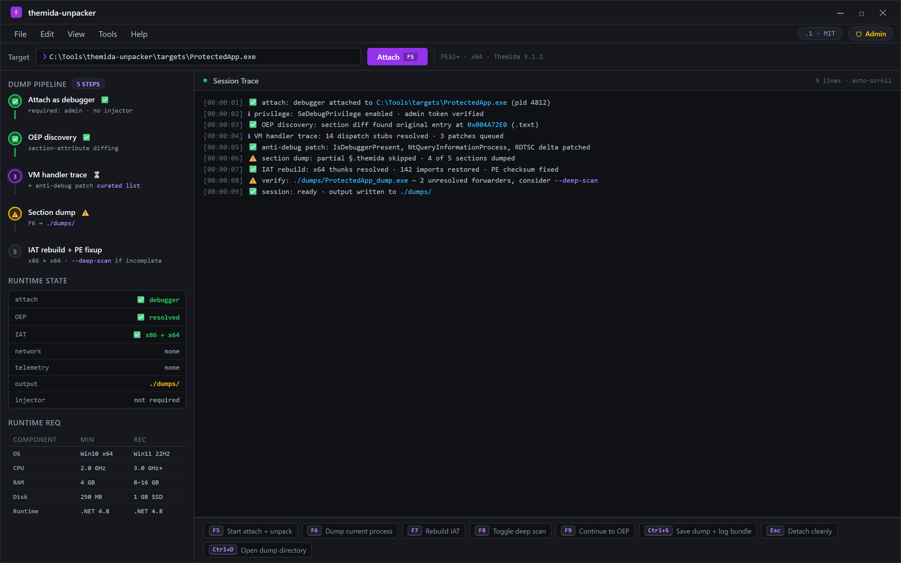
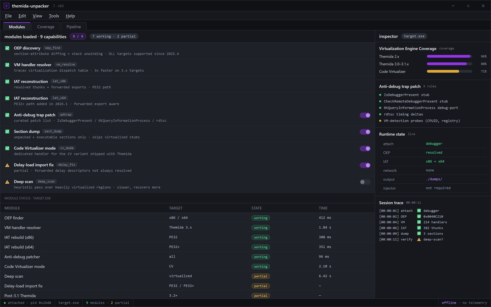
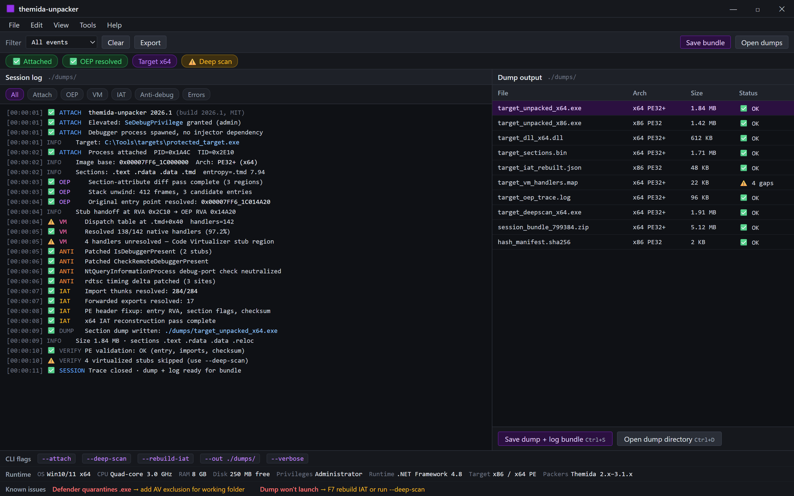

  
  
  

  

  
  
  

---

Attach, resolve OEP, dump, rebuild — one session, one trace.

---

---

## 📑 Table of Contents

- [Changelog / Release History](#-changelog--release-history)
- [System Requirements](#-system-requirements)
- [Key Features](#-key-features)
- [Hotkeys / Controls](#-hotkeys--controls)
- [FAQ](#-faq)
- [Overview](#-overview)
- [Installation](#-installation)
- [Usage Guidelines](#-usage-guidelines)
- [What is Themida Protector Patched](#-what-is-themida-protector-patched)
- [The Problem](#-the-problem)
- [The Solution](#-the-solution)
- [Virtualization Engine Coverage](#-virtualization-engine-coverage)
- [Import Reconstruction & IAT Rebuild](#-import-reconstruction--iat-rebuild)
- [Anti-Debug / Anti-VM Handling](#-anti-debug--anti-vm-handling)
- [Dump & Rebuild Pipeline](#-dump--rebuild-pipeline)
- [Known Issues](#-known-issues)
- 

  

(#-download)

---

## 🗓️ Changelog / Release History

| Version | Date | Changes |
|---------|------|---------|
| 2026.1 | 2026-02-11 | Rewritten VM handler resolver — 3× faster on Themida 3.x targets; dropped 4 legacy DLL dependencies; added x64 IAT reconstruction for protected PE32+ |
| 2026.0 | 2026-01-04 | First 2026 build. New section-attribute scanner, lighter memory footprint (~40% less RAM during dump), removed the 2024 fork's injector dependency entirely |
| 2025.4 | 2025-11-19 | Fixed OEP finder stalling on packed DLLs; added heuristic for Code Virtualizer stubs; improved anti-debug trap patch list |
| 2025.3 | 2025-09-02 | Import table rebuilder now handles forwarded exports; added `--deep-scan` flag for heavily virtualized regions |

---

## 🖥️ System Requirements

**Minimum runtime:**

- Windows 10 (1909+) or Windows 11, 64-bit
- 4 GB RAM
- 250 MB free disk for dump output + temp
- Administrator rights (required for process debugging)
- .NET Framework 4.8 (already present on most Win10/11 installs)

**Recommended:**

- Windows 11 22H2+
- 8 GB RAM or more (virtualized targets can be memory-hungry)
- SSD for dump writes
- Disable Windows Defender real-time scan on the working folder (it flags unpacker tooling — see [Known Issues](#-known-issues))

| Component | Minimum | Recommended |
|-----------|---------|-------------|
| OS | Windows 10 x64 | Windows 11 22H2 x64 |
| CPU | Dual-core 2.0 GHz | Quad-core 3.0 GHz+ |
| RAM | 4 GB | 8–16 GB |
| Disk | 250 MB free | 1 GB SSD |
| Privileges | Administrator | Administrator |
| Runtime | .NET Framework 4.8 | .NET Framework 4.8 |
| Target arch | x86 / x64 PE | x86 / x64 PE |
| Target packers | Themida 2.x, 3.x | Themida 2.x–3.1.x, Code Virtualizer |

---

## ⚙️ Key Features

| Feature | Description | Benefit |
|---------|-------------|---------|
| OEP discovery | Locates the original entry point via section-attribute diffing + stack unwinding | Dumps run without manual breakpoint hunting |
| VM handler resolver | Traces Themida's virtualization dispatch to recover native handlers | Rebuilds code sections that a plain dumper leaves as garbage |
| IAT reconstruction | Rebuilds the import address table from resolved thunks and forwarded exports | Restored binary actually imports correctly on launch |
| Anti-debug trap patch | Applies a curated patch list to common anti-debug checks | Debugger stays attached through unpacking |
| Section dump | Dumps only unpacked/executable sections, skips virtualized stubs | Smaller, cleaner output file |
| PE header fixup | Repairs entry-point RVA, section flags, and checksum | Output passes basic PE validation tools |
| x64 PE32+ support | Handles both 32-bit and 64-bit protected binaries | One tool covers both architectures |
| Code Virtualizer mode | Dedicated handler for the CV variant shipped with Themida | Wider target coverage |
| Deep scan | Heuristic pass over heavily virtualized regions | Recovers more code where static resolution fails |
| No injector dependency | Runs as a standalone debugger process | Nothing left loaded after dump |
| Offline | No network calls, no telemetry | Works on air-gapped analysis machines |
| CLI + GUI | Scriptable via flags, or point-and-click in the GUI | Fits both research and casual workflows |

Nine modules, honest status — ✅ Working vs ⚠️ Partial.

---

## ⌨️ Hotkeys / Controls

| Key | Action | Notes |
|-----|--------|-------|
| `F5` | Start attach + unpack | Prompts for target `.exe` |
| `F6` | Dump current process | Enabled once OEP is found |
| `F7` | Rebuild IAT | Run after dump |
| `F8` | Toggle deep scan | Slower but recovers more |
| `F9` | Continue to OEP | Skips remaining anti-debug traps |
| `Ctrl+S` | Save dump + log bundle | Writes to `./dumps/` |
| `Esc` | Detach cleanly | Releases the debugged process |
| `Ctrl+D` | Open dump directory | Shortcut for the working folder |

---

## ❓ FAQ

| Question | Answer |
|---------|--------|
| Is this detected by anti-cheat? | This is an unpacking tool for analysis and reverse-engineering, not a game cheat. It attaches a debugger — anti-cheat will flag that. Do not run it against live protected game clients. |
| Why does Windows Defender flag the `.exe`? | Unpacker tooling touches protected processes and patches memory — heuristic AV flags it. Add an exclusion for the working folder. |
| Do I need a paid Themida license? | No. The tool operates on already-packed binaries; you don't need the protector itself. |
| Does it work on Themida 3.1? | Yes — 2026.1 added x64 IAT reconstruction for protected PE32+ and covers 3.x targets. |
| Can it unpack a DLL? | Yes, packed DLLs are supported; the OEP finder was fixed for DLL targets in 2025.4. |
| Why is the dump incomplete sometimes? | Heavily virtualized regions may need `--deep-scan`. See [Known Issues](#-known-issues). |
| Does it phone home? | No. Fully offline, no telemetry, no network calls. |
| What do I need to run it? | Windows 10/11 x64, admin rights, and the target `.exe`. Extract and run — no install. |
| Is this legal? | It's for analysis of software you own or have permission to inspect. Use at your own risk — you are responsible for what you unpack. |

---

## 📋 Overview

| Category | Details |
|----------|---------|
| Type | Static + dynamic PE unpacker for Themida-protected binaries |
| Platform | Windows 10 / 11, x64 |
| Distribution | Portable `.exe` — extract and run |
| Input | Packed PE32 / PE32+ (`.exe` / `.dll`) |
| Output | Unpacked PE with rebuilt IAT |
| Interface | GUI + CLI flags |
| Network | None (fully offline) |
| License | MIT |

I built this after getting tired of paid unpackers that cost more than the software they were analyzing and still left me with broken imports. This repo is the free version I wish I'd had — one `.exe`, extract it, point it at a protected binary, and get a dump that actually launches. It targets Themida / Code Virtualizer output specifically, because generic dumpers choke on virtualized sections.

---

## 📦 Installation

No package manager, no `git clone`, no build step. It's a portable binary.

1. **Go to the project page** and grab the latest release archive (`.zip`).
2. **Extract** the archive to a folder you can write to — e.g. `C:\Tools\themida-unpacker\`. Don't run it from inside the `.zip`.
3. **Add an AV exclusion** for that folder (Defender will otherwise quarantine the `.exe` on first run).
4. **Run the `.exe`** — right-click → *Run as administrator* (required for process debugging). The GUI opens; no first-run wizard.
5. **Point it at your target** via `F5`, pick the protected `.exe`, and let it run.

---

## 🧭 Usage Guidelines

| Allowed | Not allowed |
|---------|-------------|
| Unpacking software you own or are licensed to analyze | Unpacking software you don't have rights to |
| Security research on your own protected binaries | Bypassing DRM/licensing to redistribute paid software |
| Malware analysis in an isolated VM | Running against live anti-cheat-protected game clients |
| Learning how Themida's VM dispatch works | Redistributing unpacked commercial binaries |
| Sharing your own dumps and findings | Using dumps to build cheats for online games |

> Educational and research use only. You are responsible for how you use this tool — the maintainer assumes no liability for misuse.

---

## 🧠 What is Themida Protector Patched

| Term | Explanation |
|------|-------------|
| Themida | A commercial Windows software protector that virtualizes code and adds anti-debug / anti-VM layers |
| Patched (Themida) | A Themida-protected binary whose protections have been modified/patched — the state this tool targets |
| OEP | Original Entry Point — where the real program starts, before the packer stub hands off control |
| VM handler | A native routine that interprets Themida's virtualized bytecode |
| IAT | Import Address Table — the list of external functions a PE needs; packers usually destroy it |
| Code Virtualizer | Oracle's virtualization engine bundled into Themida; this tool has a dedicated mode for it |
| Section attribute diff | Comparing section flags before/after unpacking to locate the real code region |

Themida-wrapped binaries rarely unpack cleanly with a generic dumper — the imports are scrambled, the code is virtualized, and the entry point is buried behind anti-debug traps. "Themida Protector Patched" describes the state this tool was built for: binaries where Themida's protections have already been patched, and it's your job to recover the underlying executable. This tool automates OEP discovery, VM handler tracing, and import reconstruction so the recovered `.exe` is actually runnable.

---

## 🧨 The Problem

- Paid unpackers cost a fortune and still hand you a broken import table.
- Generic dumpers (Scylla, etc.) work fine on UPX and fail hard on virtualized Themida sections.
- You spend hours manually hunting the OEP with a debugger, only to have anti-debug checks kick you out.
- The 2024 forks are bloated — dozens of DLLs, injector dependencies, half of them missing.
- Rebuilding the IAT by hand for a 64-bit target is tedious and error-prone.
- AV flags every unpacker you download, so you can't tell a real build from malware.
- Nothing documents *which* Themida versions actually work — you find out the hard way.

---

## 🛠️ The Solution

| Problem | Solution |
|---------|----------|
| Paid tools, broken imports | Free tool with a dedicated IAT reconstruction pass |
| Generic dumpers fail on VM sections | VM handler resolver traces the dispatch table |
| Manual OEP hunting | OEP finder via section diffing + stack unwinding |
| Anti-debug kicks you out | Curated trap-patch list keeps the debugger attached |
| Bloated 2024 forks | 2026.1 dropped 4 DLL deps and the injector entirely |
| Hand-rebuilding 64-bit IAT | Automated x64 PE32+ import rebuild |
| Can't tell real builds from malware | Open repo, documented build, MIT license |
| Unclear version coverage | Explicit 2.x–3.1.x + Code Virtualizer support table |

---

## 🎯 Virtualization Engine Coverage

**Themida version support**
- Themida 2.x — full OEP + IAT support
- Themida 3.0 – 3.1.x — full support incl. x64 PE32+
- Code Virtualizer — dedicated mode

**What the VM handler resolver does**
- Walks the dispatch table to recover native handlers
- Rebuilds virtualized code sections into real machine code stubs
- Falls back to `--deep-scan` heuristics for heavily obfuscated regions

**Limits, honestly**
- Fully virtualized functions with no native anchor can't always be recovered — you get a stub, not the original logic
- Newer Themida builds (post-3.1) may need a handler update; track the changelog

---

## 🧬 Import Reconstruction & IAT Rebuild

**How it works**
- Resolves thunks against loaded modules
- Handles forwarded exports
- Repairs the import directory in the output PE

**What you get**
- An output `.exe` / `.dll` that imports correctly on launch
- Fixed entry-point RVA, section flags, and checksum

**When it fails**
- Delay-loaded imports sometimes need a manual pass — see [Known Issues](#-known-issues)

---

## 🕵️ Anti-Debug / Anti-VM Handling

**Trap patches applied**
- `IsDebuggerPresent` / `CheckRemoteDebuggerPresent` stubs
- `NtQueryInformationProcess` debug-port checks
- Timing checks (`rdtsc` deltas)
- VM-detection probes (CPUID, registry artifacts)

**What this buys you**
- The debugger survives long enough to reach the OEP
- No manual breakpoint-and-patch loop for the common checks

**What it does not do**
- It doesn't make the tool undetectable by *anti-cheat* — this is analysis tooling, not a game hack

---

## 📤 Dump & Rebuild Pipeline

Every timestamp, every trap patch, every file written to ./dumps/.

**Pipeline stages**
- Attach → freeze target
- OEP resolve → section diff + stack unwind
- Dump → executable sections only
- IAT rebuild → thunk resolution + forwarded exports
- PE fixup → RVA, flags, checksum
- Write to `./dumps/` with a matching log bundle

**Output layout**
- `./dumps/<target>.unpacked.exe`
- `./dumps/<target>.log`
- `./dumps/<target>.iat.txt`

---

## ⚠️ Known Issues

- Windows Defender may quarantine the `.exe` on first run — add a folder exclusion.
- Delay-loaded imports occasionally need a manual pass after rebuild.
- Fully virtualized functions without a native anchor may only be recovered as stubs.
- Some anti-cheat-protected targets will detect the debugger attach — do not run against live game clients.
- Themida builds newer than 3.1.x may require a handler update; check the changelog.

---

  

